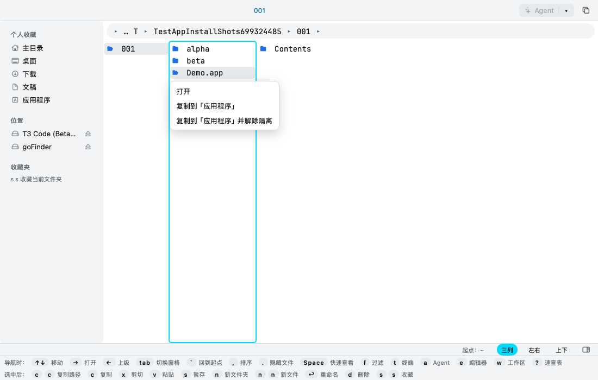
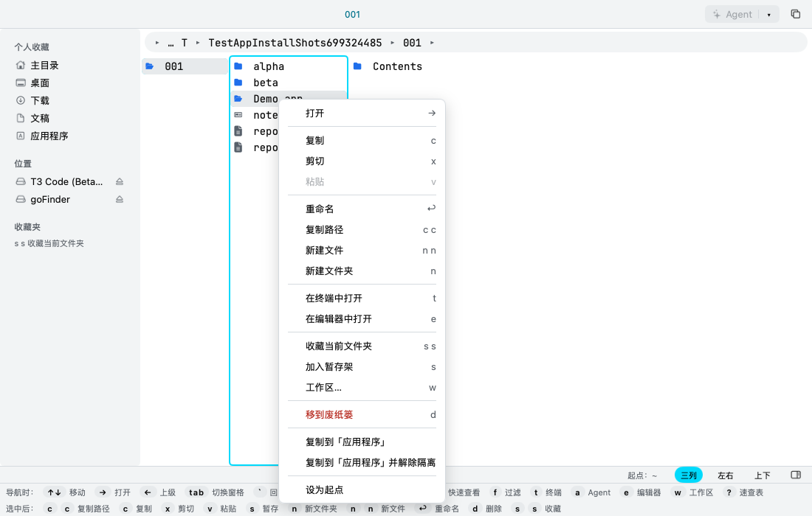
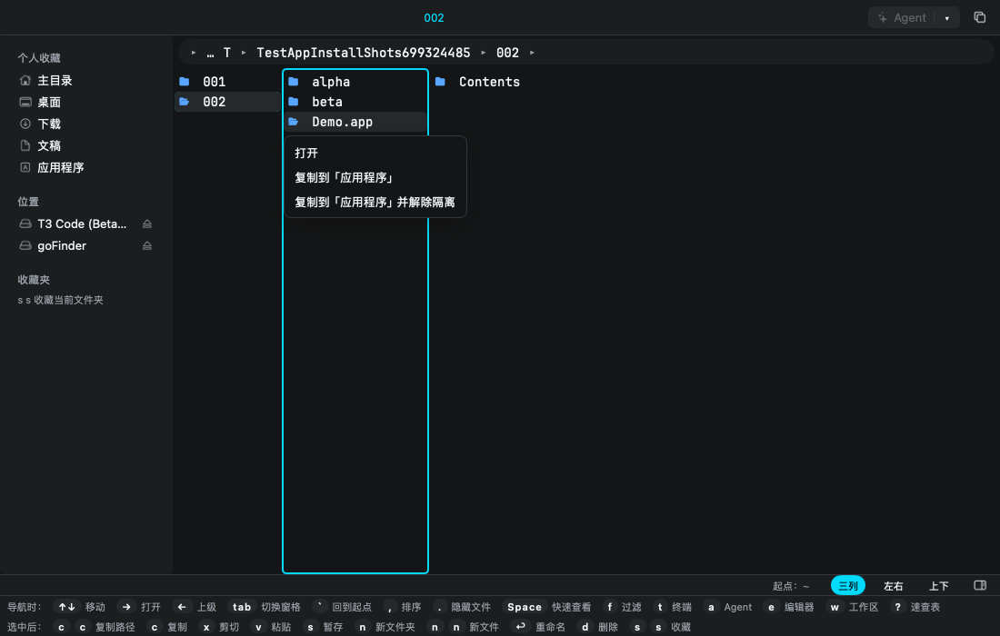
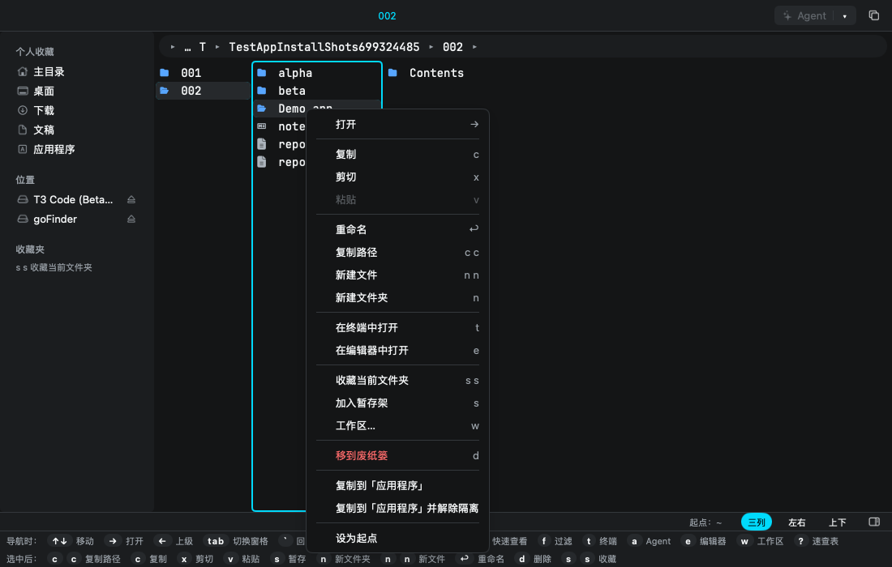

# PRD：应用包安装菜单（Issue #6）

> 来源：本次 Codex 独立 Worktree 文档代理会话，2026-11-13；[Issue #6：针对.app类型文件的优化](https://github.com/aoyamashou/goFinder/issues/6)。Issue 原文由父代理提供，父代理已回复受理；本文未再次读取或回复 GitHub。
> 要改什么及为什么：为待安装的本地 `.app` 提供「复制到本机应用程序」和「复制到本机应用程序并解除隔离」，减少手工复制和终端操作，同时保留已安装应用的启动入口。
> 边界：规划阶段只提交本文与索引；本次依用户「照 Claude 的方法执行」授权，实现审查记录限定的代码与测试。实际系统命令只用于临时夹具，不安装到本机 /Applications、不提权、不改系统设置、不合并 main、不发版或关闭 Issue。不改 README、官网、版本、CHANGELOG、其他功能或依赖。
> **状态：已实现，待 Claude 代码审查（依据 6031419，2026-11-13）。** 以文末「Claude 审查记录」为准；它大幅收窄了第 4–9 节的方案，冲突处一律以审查记录为准。
> 分支：`t3/app-install-prd`（系统准备的独立功能分支，保留）；基线：`86a0b4620c4891b067cdf05bd1ca0b2c998a8ddd`。Worktree：`/Users/corndog/.t3/worktrees/MygoFinder/t3-9a14184c-6d1d76300c54bdee`。开工目录干净；无 upstream，仅 `git fetch origin`，HEAD 与 origin/main 相同，未合并其他分支。

## 1. 原需求、合理性与建议的区分

Issue 认为进入 `.app` 查看包内容没有意义，要求用户选择打开 `.app` 时弹出有两个选项的右键菜单；第一项复制到 `/Applications`，第二项复制后执行 `sudo xattr -r -d com.apple.quarantine {对应的应用程序}`。

安装入口有实际用途，适合 goFinder 的文件管理定位；但「当前打开会进入应用包」与本地实现不一致，不能按修复进入包的问题处理。原文也没有定义已安装应用、冲突、提权授权和符号链接处理。解除隔离不等于修复签名或证明应用安全，复制成功也不保证应用能运行。

下列为**建议，必须由 Claude 明确接受或修改**：

- 对未安装位置的有效本地应用包，打开动作弹出两项安装菜单；已安装位置继续启动。原需求没有这个例外，不能静默视作已获批准。
- 一级右键菜单增加相同两项，保留其他文件操作；不把整个原右键菜单替换掉。
- 同名直接拒绝，不覆盖、合并或自动改名；ZIP 内和根符号链接暂不支持安装，先解压或定位真实包。
- 保留第二项的用户意图，但不机械执行原文的 sudo 命令。先使用当前用户权限；需要管理员授权时按第 6 节审查结果处理，不能默认静默提权。
- 第二项执行前说明「仅对信任的应用解除隔离；可能降低 macOS 对下载应用的保护」，提供取消。第一项不夹带解除隔离，也不自动启动应用。

## 2. 基于本地源码的事实

| 位置 | 已核实事实及影响 |
|---|---|
| `gui/app.go:openEntry`、`isApp` | 本地 `IsDir && isApp && !vfs.InZip` 调用 `a.sys.Open` 启动；isApp 仅大小写不敏感地检查 `.app` 扩展名，不验证 bundle。ZIP 内目录会进入目录。 |
| `gui/actions.go` | `open` 默认 Right、Cmd+Down，可选 Vim 模式增加 l；Enter 默认重命名。新动作和键位必须在此定义，提示从有效键位读取，不能误写成 Enter 默认打开。 |
| `gui/view.go`、`gui/columns.go` | 当前列和子项列表双击经 openEntry；侧列右键通过 contextMenuPre/pre 锁定被点项目；普通选择、双击与预览单击导航有不同路径，须分别验证。 |
| `gui/view.go:contextMenuPre`、`gui/rightclick.go` | 右键菜单受 config.ContextMenu 控制，父列/子列先高亮，选择命令后才导航并执行；安装必须使用被点击项快照，不能误用旧光标或多选。 |
| `gui/app.go:popup/popMenu`、`gui/view.go:popAt` | 已有程序触发菜单及行锚点模式；MyGo v0.8.3 有 PopoverMenuButton/ContextMenuBase，不必假设或新增框架 API。是否直接复用须以实际 UI 测试确认。 |
| `internal/vfs/vfs.go:ReadDir` | Lstat 并记录 IsLink；指向目录的符号链接也会置 IsDir。只看 IsDir/后缀会误把链接当可安装实体。 |
| `internal/fsops/fsops.go:Copy/copyAny/copyFile` | Copy 自动 UniqueName；copyAny 用 Lstat/Readlink/Symlink 保留链接、不沿链接复制；普通文件 O_EXCL。目录权限额外 OR 0700，时间仅写访问/修改为源修改时间；无 xattr、资源叉、ACL、硬链接关系或创建时间保留。不能未经补充验证直接用于安装应用。 |
| `gui/sys.go:system/realSystem` | 有 Open、Trash、RunShell 和可替代 fakeSys 的模式，没有应用安装或管理员授权接口。RunShell 为 sh 命令入口，不应复用于本功能。 |
| `go.mod`、本地 MyGo | MyGo v0.8.3、纯 Go 无 cgo；purego 已为间接依赖，但不能据此认为已有安全提权能力。 |
| `docs/plan.md`、`AGENTS.md` | 已有自动更新；本机 `/Applications/goFinder.app` 禁止复制覆盖，只走自动更新。修订十八已被 Issue #10 使用，后续实现必须取当时最新编号，本阶段不占编号。 |

已阅读 AGENTS.md、CLAUDE.md、docs/plan.md 相关架构/资源/更新/修订记录、docs/design-system.md、MyGo 维护技能及现有 folder-init、vim-keybindings、intel-support PRD。新界面沿用 tok()/px()、原生菜单和现有结果文案；耗时操作走 a.async/a.post，不跨帧保存 Element 或在 worker 保存 UI Context。

## 3. 完成标准与阻塞门槛

后续实现完成必须同时满足：

1. 打开、双击、右键、键盘菜单均遵循同一资格判断，普通单击选择不安装；已安装应用仍能启动。
2. 用户明确选择前不写磁盘；取消菜单或确认框不执行安装。来源和目标在提交任务时固定，切换目录/窗格不改变目标、不夺焦点。
3. 原名复制到 `/Applications/<原应用包文件名>`，保留源，始终不覆盖任何已存在对象，包括大小写等价名、空目录、悬空链接和并发出现的目标。
4. 第一项保留 quarantine 与其他 bundle 元数据；第二项只移除目标 bundle 树的 com.apple.quarantine，不触碰源、外部链接目标或其他属性；不改签名、不重签第三方应用。
5. 复制失败、取消、权限不足、签名损坏、解除隔离失败均反馈真实阶段；复制成功但后一步失败必须报告部分成功和目标路径。
6. 无 shell 路径拼接、盲目 sudo、密码收集/持久化或永久删除；本机 goFinder 安装与自动更新不受影响。
7. 临时目录夹具、fakeSys、UI 和必要原生验证通过，完成项目代码最低检查及浅深色截图；实现证据写回本文和 docs/plan.md。

覆盖/合并、链接越界、签名被复制破坏、目标错位、误报成功、UI 阻塞、重复提交或凭据泄漏任一存在时，不得宣布交付。提权与无覆盖原语未裁定前，不得以「先实现再补」放行。

## 4. 交互与资格规则（建议方案，待审）

### 4.1 何时安装、何时启动

- 已安装位置定义：解析规范路径后，位于 `/Applications`、`/System/Applications`、当前用户 `~/Applications` 的应用包（含其子目录）。这些包打开时继续走 system.Open，右键不显示安装两项。其他管理员自定义安装位置如何识别不做全盘扫描，作为已知限制记录。
- Downloads、挂载 DMG 的 `/Volumes/...` 等其他本地位置：有效应用包打开时显示两项安装菜单，不进入包、不立即启动。只读源可复制，源不可读则失败。
- 菜单以项目行作锚点；无法定位可见行时用稳定的窗口锚点，不能存过期 Element。菜单打开后 ↑↓ 选择，Enter 执行当前项，Esc/点外部取消；打开菜单的按键不能连带确认第一项。关闭后焦点回原列表。
- 用户自定义 `open` 键位和 Vim l 都走同一入口；Enter 继续按现有键位表处理。右键或已有键盘菜单入口显示两项安装命令；新安装动作不设默认快捷键，以免冲突。
- 普通右键菜单保留复制、复制路径等既有动作；新增安装项独立一组，建议对合格应用包固定显示，不因旧 contextMenu 缺少新 ID 而消失；这对自定义菜单语义的改变须 Claude 审查。菜单栏新增动作仅对合格单项启用。
- 仅单个应用包安装。右键作用于被点项；多选不批量安装，须明确单项目标或禁用。菜单需显示本次源名称和目标，避免“选中多个却只装一个”的歧义。
- 第二项确认框显示源、目标及解除隔离说明；取消不复制。运行时禁用重复触发，显示阶段文字；不自动弹终端、不自动打开已复制应用。

### 4.2 无效输入与特殊路径

| 情况 | 规定行为 |
|---|---|
| 普通文件名以 .app 结尾 | 不视为应用包，不显示安装命令，保留普通文件打开。 |
| 目录以 .APP 等结尾 | 扩展名大小写不敏感；仍须通过包验证。 |
| 伪包、缺/坏 Info.plist、缺启动文件 | 返回「无法安装：不是有效的应用包」及原因，不复制、不解除隔离、不偷偷当文件夹打开；查看包内容不是本需求新增功能。 |
| ZIP 内应用包 | 本轮安装命令禁用并说明「请先解压应用包」；保留 ZIP 现有浏览/解压路径，不宣称 ZIP 元数据完整。 |
| 应用根目录是符号链接/别名 | 不沿链接安装，提示定位真实应用；Finder alias 不是普通符号链接，未实现解析时不得自动解释为 bundle。已安装位置的现有启动不因此被改为安装。 |
| 包内符号链接 | 原样保留（含常见 Framework 版本链接）；不沿外部链接复制内容或解除隔离。损坏链接不会被自动修复；影响启动结构时验证失败。 |
| 源在目标目录、源目标同对象、路径别名指向同对象 | 安装拒绝；打开已安装包继续启动，不能产生 Foo 2.app。使用规范路径与文件身份检查，不能只比较路径字符串前缀。 |
| 同名或大小写等价冲突 | 提示「目标已存在，未复制」；不询问覆盖、不自动改名、不合并，也不对已存在目标解除隔离。以目标文件系统实际规则为准。 |
| goFinder 自身 | 源 bundle ID 与本应用相同，或目标规范路径为 `/Applications/goFinder.app`（含大小写/路径别名）时禁止安装，提示「请通过检查更新升级 goFinder」。重命名包也不能绕过；已有 goFinder 正常启动不受影响。 |

建议最低 bundle 验证：根必须是实际目录；Contents/Info.plist 可解析（XML/二进制，不能用字符串匹配），CFBundlePackageType 为 APPL，CFBundleExecutable 为单一文件名且 Contents/MacOS 下有可执行实体；必需入口若经内部链接解析，必须仍在包内。拒绝路径穿越、特殊设备/FIFO/socket 和不可读必需项。此规则会排除部分旧式/非标准 app，Claude 应确认是否接受此范围，不能声称完整复刻 LaunchServices。验证结构不等于安全认证；不以未签名为伪包的同义词。

## 5. 复制、元数据和结果方案（待审）

建议新增独立的应用安装逻辑，不改普通 fsops.Copy 的现有语义：

1. 取得不可变请求：源绝对路径、名称、安装模式、bundle ID、文件身份；后台验证源和目标父目录，拒绝 ZIP、根链接、自安装、同对象及现有目标。提交与实际写入前重新核实，不只信列表缓存。
2. 在目标同卷的独占暂存目录复制，建议用固定 `/usr/bin/ditto`，参数数组显式启用 `--rsrc --extattr --acl --qtn`，隔离 DITTONORSRC 等会改变语义的环境；禁止 thinning、--noqtn 和覆盖真实目标。命令路径和选项固定，源目标为独立 argv 绝对路径，不经过 sh。
3. ditto 不能保证目标独占，且会跟随命令行根符号链接；必须先排除根链接，并在受控暂存目录执行，不直接对真实已存在 app 调 ditto。父目录/文件被并发替换的风险必须通过文件身份、目录句柄或等效机制控制；提权 worker 尤其不能信任用户可替换的路径。
4. 对比包结构、内容、执行位、链接及关键元数据。已签名源先验证并记录签名身份/CDHash，暂存副本签名应保持有效且一致；源签名本已损坏则停止并提示，不能重签或靠解除隔离掩盖。未签名应用可按明确提示复制，但不宣称可信。签名验证与公证、Gatekeeper 接受度是不同结论。
5. 用可证明**目标不存在才发布**的机制提交为 `/Applications/<原名>`。普通 os.Rename 和「先 Lstat 再 rename」不满足并发无覆盖；建议审查 Darwin 排他重命名原语及纯 Go 调用方式。系统/文件系统不支持时安全失败，不退回可覆盖 rename。另选“独占预建最终目录再填充”会暴露不完整包，需要 Claude 明确接受降级和失败管理，不能默认为等价。
6. 复制发布成功才算安装成功。第二项随后在已固定身份的目标上按第 6 节解除隔离；源始终不变。不得为解除隔离失败回滚已完成的安装。
7. 结果分阶段返回：未复制；复制完成；复制完成但解除隔离取消/失败/部分完成；全部完成。例：「已复制到 /Applications/Foo.app，但解除隔离失败：没有权限；部分项目可能已处理」。没有 quarantine 时应视为该项已满足，不能吞掉其他错误。
8. 复制中取消/空间不足/卷卸载/进程超时：不发布残包，报告真实错误及暂存位置。清理仅走 system.Trash；移废纸篓失败保留并说明位置，不 os.RemoveAll，不清理来源或其他安装。发布后取消第二阶段同样报告部分成功。应用退出中断留下的暂存物不自动继续安装或提升权限。

资源/权限所有者可能受当前用户权限和文件系统限制，ditto 文档不能代替夹具验证。ACL、xattr、资源叉、权限、时间、内部链接、签名均应有证据；不能宣称所有元数据逐位不变。耗时验证、复制及命令执行不在每帧运行，采用可取消后台任务；取消后等待进程退出，避免后台继续写入。

## 6. 解除隔离、提权与 Claude 必须裁定的决策

解除隔离范围固定为**本次新复制成功的目标应用树**：仅 com.apple.quarantine；不对 `/Applications` 本身、源包、整个卷或之前已安装目标操作。不使用 xattr -c，不清空其他属性。保留包内链接，不沿链接进入包外目录；硬链接与文件身份也须防止影响包外已有对象（复制不得与源/外部文件共享可变硬链接）。

原文的递归 xattr 命令缺少链接安全策略。本机 man xattr 指出默认链接操作会指向链接目标，-s 才操作链接本身；仅据 man 无法保证 -r 与复杂链接/并发替换的组合完全满足本需求。建议使用不跟随链接的遍历和基于文件描述符的属性删除，或经夹具证明安全的逐项调用；不要把加一个 -s 当成已解决所有父路径竞态。新系统 NOFOLLOW_ANY/RESOLVE_BENEATH 的最低版本可用性仍待核实，不能从本机新系统 man 推断 macOS 12 均支持。

| 决策 | 建议与必须确认的内容 |
|---|---|
| D1 菜单与启动条件 | 接受第 4 节已安装位置例外、有效包规则、ZIP/根链接限制、右键固定安装项及自安装禁令；有变更直接改正文。 |
| D2 复制与元数据 | 接受独立安装服务和 ditto 暂存方案；明确权限/所有者/时间的保留标准、源变化检测、签名验证失败处理，验证不能破坏 bundle。 |
| D3 无覆盖提交 | 选定排他发布原语、纯 Go/无新增依赖的可行接入、最低系统支持和竞态测试；无证明就不放行。现有 purego 为间接依赖不等于已完成接入评估。 |
| D4 安全移除属性 | 选定描述符方式或不跟随链接方案，定义内部/外部/循环链接和并发替换处理，证明只作用于本次目标。没有属性仅 ENOATTR 可视作幂等成功，权限/IO 错误必须报告。 |
| D5 管理员授权 | **建议第一版不自动提权**：普通权限先尝试，复制权限失败报告未安装，解除隔离权限失败报告部分成功，并提供人工处理说明。这是对原文 sudo 的实现范围收缩，必须明确批准；否则不能视作满足完整需求。若必须支持提权，先明确受系统管理的授权 UI/受限 helper、参数化 IPC、来源/目标不可替换、取消与超时，再复审。不可把 AppleScript 的 shell 字符串拼接或弹终端 sudo 当安全实现，不输入/保存管理员密码，不 sudo -S、不缓存凭据，不为整应用常驻 root。 |
| D6 取消与残留 | 明确取消边界、任务去重、暂存目录识别和仅移废纸篓的清理行为；退出后不自动重试特权步骤。 |

是否能在现有纯 Go、无新依赖、插件白名单内提供安全系统授权尚未验证。D5 若选择自动提权且需要新 helper/依赖/架构，先更新边界并取得对应范围授权，不能绕过项目约束；未解决则保持本文不可执行。

## 7. 本地技术证据与不确定性

规划阶段只读取源码与本机帮助；未执行 ditto 复制、sudo、xattr 删除、安装或签名修改。

| 证据 | 能支持什么 | 不能推出什么 |
|---|---|---|
| 本机 `man ditto` DESCRIPTION、OPTIONS | 已有目标会合并并覆盖；参数根链接会跟随、遍历中的链接不跟随；rsrc/extattr/acl/qtn 保留选项及 DITTONORSRC 环境影响。 | 不能仅据帮助断言所有 app 完整、安全无覆盖，也不能证明实际文件系统/权限的保留结果。 |
| 本机 `man xattr` OPTIONS、EXIT STATUS | -d 删除指定属性，-r 递归，-s 操作链接本身，错误非零。 | 没有直接证明 -r 的所有链接组合不会越界，也没有要求所有操作必须 sudo。 |
| 本机 `man removexattr` | XATTR_NOFOLLOW 与 fremovexattr(fd)；ENOATTR 与权限错误可区分。 | 本机列出的较新安全 flag 不等于项目最低系统可用；需兼容核实。 |
| 本机 `man renamex_np`（展示 RENAME(2)） | 普通 rename 可移除已有目标，RENAME_EXCL 可在支持的文件系统上拒绝已有目标。 | 不能证明现有 Go 标准库暴露该原语或已解决父路径竞态。 |
| 本机 `man codesign` | --verify 用于验证，--deep 可检查嵌套代码；display 不能代替完整验证。 | 验签不等于公证、无恶意或一定通过系统启动策略。 |
| MyGo v0.8.3 `ui/doc.go`、`ui/api_gen.go` 及现有 popup/popAt | 原生菜单、键盘/焦点及稳定数据状态的实施基础。 | 未做本功能 UI 原型，不宣称锚点、焦点恢复和辅助功能已验证。 |

以上是本机随系统安装的手册，不引用未经读取的在线 Apple 文档；最终实现须记录命令版本/系统版本、兼容性与夹具结果。安全与兼容性尚未验证的事项在审查前不能改写成已完成。

## 8. 后续实施步骤与预期影响文件

仅供放行后的开发会话执行，本阶段没有实施：

1. Claude 修改并提交本文，在末尾逐项裁定 D1–D6、更新状态；仍有阻塞时写明不可执行，不启动代码工作。
2. 开发会话重新确认独立分支、工作区与唯一开发角色，按裁定做最小系统/逻辑验证；安全原语或兼容性不成立时先回到 PRD 复审。
3. 建立可替代的安装服务与结果结构，临时目录模拟目标；再接 openEntry 和两种菜单，不改通用复制。
4. 补齐有意义的失败与 UI 验证，记录真实限制；更新本文与 docs/plan.md 对应新修订，并按当时授权提交/推送功能分支。
5. 等待独立代码审查；合并、Issue 回复/关闭和发版由人类/父代理另行处理。

| 预期文件 | 改动目的 |
|---|---|
| `internal/appinstall/`（建议新增）及测试 | 本地包校验、安装请求/结果、复制发布、链接边界与取消；不依赖 MyGo。Darwin 原语封装位置依 D3/D4 裁定。 |
| `gui/sys.go`、`gui/main_test.go` | 参数化安装/授权接口和 fakeSys，不借 RunShell 执行路径。 |
| `gui/app.go`、建议 `gui/appinstall.go` | 打开分流、菜单请求快照、任务状态、异步结果。 |
| `gui/view.go`、`gui/columns.go` | 当前/侧列菜单、稳定锚点、焦点与多选行为。 |
| `gui/actions.go`、`gui/menu.go` 及相关 UI 测试 | 安装动作统一登记，菜单栏覆盖、有效性判断；不擅自加默认键位。 |
| 本 PRD、`docs/plan.md`、必要 `AGENTS.md` 索引 | 审查决策、实现与验证证据；不提前写已实现。 |

若验证表明必须改其他系统集成、依赖或更新机制，先修改 PRD 复审，不扩大实现。

## 9. 验收与失败路径清单（实现阶段）

全部写入临时 fixture 或 fakeSys；测试服务允许注入目标根目录，正式产品固定 /Applications，不提供任意 root 路径的特权接口。本机已安装 goFinder 不得用作覆盖/隔离测试对象。

| 场景 | 通过标准 |
|---|---|
| Downloads/DMG 有效包打开 | 双击、Right、Cmd+Down、自定义 open/Vim l 都只打开两项菜单；单击无副作用；菜单 Enter/Esc、点外取消正确。 |
| 已安装包与普通目录/文件 | 三种已安装根含子目录继续启动；普通目录/文件原行为保持；Enter 默认重命名回归通过。 |
| 右键和多列 | 父列、当前列、子列、键盘菜单、菜单栏锁定同一明确源；切窗格/刷新/重绘不误装、不重复，配置自定义菜单行为符合 D1。 |
| 无效包/ZIP/链接 | 假 .app 文件、损坏 plist/启动文件、二进制 plist、大小写后缀、ZIP 内包、根链接/alias 按规则处理；无误写。 |
| 冲突与身份 | 已有同名文件/空目录/包/悬空链接、大小写冲突、发布时并发创建、源目标同对象全部零覆盖；父路径替换安全失败。 |
| 自身保护 | 原名和改名 goFinder、相同 bundle ID、大小写/别名目标均不能复制到受保护路径；仅 fakeSys/临时路径验证，实际安装保持自动更新。 |
| 普通复制模式 | 可读只读源可安装；数据/执行位/资源叉/ACL/xattr/quarantine/时间符合 D2；Framework 链接原样，源无变化。 |
| 签名 | 自建临时签名夹具（Apple_self_dev）复制前后 verify 与身份一致；已损坏签名拒绝；未签名按裁定提示，不重签。 |
| 隔离模式 | 临时夹具无 quarantine 为幂等；有属性只删目标该项，其他属性/签名保留；外部、循环、悬空、内部链接及并发替换不越界，外部哨兵不变。 |
| 权限和授权 | 无写权限/只读目标/空间不足/源消失分别报错；需要提权只按 D5 方案；用户拒绝、授权取消/超时不重复弹框、不存凭据。 |
| 部分成功 | 复制成功、部分属性删除后权限或 IO 失败，报告目标路径和可能部分处理；源/已有应用不改、不声称全部成功、不自动回滚。 |
| 取消、残留、异步 | 各阶段取消、命令挂起/超时、卷移除、关闭窗口、导航切换、重复按键有确定结果；未完成副本不发布，残留仅移废纸篓，失败显示位置。 |
| 路径参数安全 | 名称含空格、中文、单双引号、换行、反引号、美元符、前导横线时路径为独立 argv；无 shell 执行，无日志泄露密码。 |
| UI 与资源 | 浅深色菜单/确认/进度/错误截图可读，焦点正确，等待期间可导航；无每帧 IO、后台轮询、额外插件或依赖。 |

代码阶段最低检查：`gofmt -l gui internal` 无输出、`go vet ./...`、`go tool mygo vet .`、`go tool mygo vet ./gui`、`CGO_ENABLED=0 go test ./...`；并发状态变更跑相关 race 测试。原生交互使用临时配置/夹具和 Apple_self_dev 签名开发产物，不覆盖本机应用；真实 /Applications 权限和提权如未获安全验证条件须诚实记录，不能用 fakeSys 结果冒充实测。

## 10. 本阶段交付与审查入口

- 本阶段仅调研、PRD 与文档索引；未改代码、运行全量测试或实际安装。
- 文档验证：提交前检查文件范围、完整 diff、关键约束覆盖和 `git diff --check`。纯文档不跑全量代码测试。
- Claude 接手时首先裁定第 6 节 D1–D6，在本文维护唯一最新结论，附审查日期与 commit；未明确写「可以执行」前保持不可执行。
- 本阶段提交后停止，等待人类接手 Claude 审查。没有创建 PR、合并、发版或向 GitHub 留言。

### Claude 审查记录（2026-11-13）

> 审查依据：规划 commit df187e4；核对了 `gui/app.go` 的 `openEntry`/`isApp`/`popup`、`gui/rightclick.go`、`gui/sys.go` 的 `ContextMenu`、`go.mod`（没有 `golang.org/x/sys`，`purego` 只是间接依赖）。

**结论：可以执行，但按下面收窄后的范围实现。** 需求合理。第 4–9 节把一个「复制到应用程序」功能写成了带签名比对、文件描述符级属性删除、排他重命名原语和提权方案的安装器，这与项目「资源优先、界面朴素、不加依赖」的原则不符，也远超 Issue 的要求。第 4–9 节只作背景参考，实现以本节为准。

**D1 菜单与启动条件：修改后接受。**
- 「已安装位置」= 规范路径位于 `/Applications`、`/System/Applications`、`~/Applications` 之下：打开时照旧直接启动，右键不加安装项。
- 其他本地位置的应用包，打开（双击、`open` 键位、Vim `l`）弹出三项菜单：**打开**、**复制到「应用程序」**、**复制到「应用程序」并解除隔离**。保留「打开」，这样从 Downloads 或 DMG 直接运行的老用法只多一次选择，不会丢失。菜单复用现有 `popup`/`popMenu`，Esc 或点外面取消。
- 右键菜单：对符合条件的应用包，在用户配置的菜单项后面固定追加一组两个安装项（分隔线隔开）。它们**不是键位动作**，不进 `actions.go`、不进 `contextMenu` 配置、不设快捷键、不进菜单栏，因此不影响 `TestMenuCoversActions`，也不受旧 `contextMenu` 配置影响。
- 只作用于被点或光标所在的那一项，不批量安装。
- 「应用包」的判定：扩展名不区分大小写为 `.app`、是真实目录（不是符号链接）、并且 `Contents/Info.plist` 是文件。不解析 plist、不检查可执行文件。不符合条件的照旧按目录处理（就是现在的行为）。ZIP 内的应用包不显示安装项，保持现状。

**D2 复制与元数据：用 `ditto`，不做签名比对。**
- 用 `exec.Command("/usr/bin/ditto", …)` 以独立参数调用，不经过 shell。显式加 `--rsrc`，以免环境变量 `DITTONORSRC` 影响结果；本机 `man ditto` 写明扩展属性、ACL 和隔离属性默认都会保留。
- 先复制到同一目录下的隐藏暂存路径 `/Applications/.<名称>.gofinder-<随机>`，成功后再重命名为 `/Applications/<原名>`，失败时不会留下半个应用。
- 不做 codesign 验证、内容比对或 CDHash 记录：`ditto` 是系统自带的标准复制工具，签名问题不在这个功能的范围内。

**D3 不覆盖：先检查再重命名，接受极小的竞态。**
- 开始前和重命名前各用 `os.Lstat` 检查一次目标；目标已存在（文件系统不区分大小写时，大小写不同也算存在）就提示「/Applications 里已有 <名称>，未复制」。
- 不引入 `x/sys` 或 purego 去调用 `renamex_np`。两次检查之间被别人抢先创建同名项的概率很小；而且重命名到一个非空目录本来就会失败，只有目标恰好是空目录这一种情况会被替换，可以接受。
- 这也覆盖了 goFinder 自己：`/Applications/goFinder.app` 已存在，所以一定会被拒绝，不需要另加 bundle ID 判断。

**D4 解除隔离：复制时直接不带隔离属性。**
- 第二项用 `ditto --noqtn src staging`，复制时就不带 `com.apple.quarantine`，不需要事后执行 `xattr` 或 `sudo`，也就没有链接越界和「复制成功、解除隔离失败」的中间状态。
- 实现时用一个带隔离属性的临时夹具验证：暂存副本里任何一项都不再有 `com.apple.quarantine`，其他扩展属性还在。如果本机 `--noqtn` 达不到这一点，就改为在**重命名之前**对暂存目录执行 `/usr/bin/xattr -d -r -s com.apple.quarantine <暂存路径>`（独立参数调用）。两种做法都只动新副本，不碰源文件。
- 菜单项文字本身已经说清楚了，不再弹确认框。

**D5 管理员授权：第一版不提权，接受。**
- 管理员账户对 `/Applications` 本来就有写权限，普通情况下不需要 sudo。没有权限时报「没有权限写入 /Applications」，不弹授权框、不收集密码、不调用 `sudo`、AppleScript 或终端。

**D6 取消与残留：简化。**
- 复制放在 `a.async` 后台执行，状态栏显示「正在复制 <名称>…」，结束后显示结果；成功时结果里写上目标路径。不做取消按钮或进度条，也不做超时。
- 同一个源正在复制时，再次触发直接忽略。
- 失败时把暂存目录用 `system.Trash` 移到废纸篓；移不了就在状态栏写出暂存路径。不自动重试，不启动刚复制的应用。

**实现边界**
- 新逻辑放在 `internal/appinstall`（判定、目标路径、暂存命名、执行器接口），不依赖 MyGo，`ditto` 和 `xattr` 的调用可以替换，方便测试。界面接线放在 `gui/`，`system` 接口加一个安装方法，`fakeSys` 跟着加。不改 `fsops.Copy`，不碰 `RunShell`。
- 验证：
  - 单元测试覆盖判定（真目录、文件、符号链接、缺 Info.plist、大小写后缀、已安装位置、ZIP）、目标已存在、暂存失败后移到废纸篓、路径含空格/引号/中文/前导 `-` 时参数独立；
  - 用临时目录代替 `/Applications`，跑一次真实 `ditto` 和 `ditto --noqtn`，确认隔离属性的结果；
  - UI 测试：打开时弹三项菜单、右键追加两项、已安装位置照旧启动；
  - 浅色、深色菜单截图各一张；
  - 不在本机真实 `/Applications` 上做覆盖测试，也不动本机已安装的 goFinder。
- 完成后按 AGENTS.md 在 `docs/plan.md` 加新的修订一节（编号取当时最新），在本文末尾标注实现 commit，交 Claude 代码审查。

### 实现与验证（2026-11-13，Codex 开发会话）

来源：用户「照 Claude 的方法执行」，严格依审查提交 `6031419` 的裁定。

- 新增 `internal/appinstall`：轻量应用包判定、规范路径安装位置识别、同名检查、隐藏暂存与系统命令执行器。新增 `gui/appinstall.go`，通过 `system.InstallApp` 接入后台任务；同源忙碌期间忽略重复请求，主线程接收结果。
- 本地未安装应用打开时显示三项菜单；已安装应用直接启动。右键在原配置菜单后固定追加两项，仅处理被点击项，不改动作、键位、菜单栏或普通文件复制。无 Info.plist 的 `.app` 目录按目录浏览，根符号链接和 ZIP 不提供安装。
- 用独立 argv 执行 `/usr/bin/ditto --rsrc --extattr --acl --qtn`。夹具发现直接写入已创建的暂存目录会丢失**包根**扩展属性，因此用隐藏的独占暂存父目录，在其内让 ditto 创建原名 bundle，完成后重命名内部 bundle。成功后将空暂存父目录移到废纸篓，失败时同样只清理自有暂存目录；清理失败保留路径并如实提示，不把已发布副本误报为未复制。
- 本机实测 `ditto --rsrc --noqtn` 仍保留根 `com.apple.quarantine`，已采用 D4 明确允许的备用方案：复制后、发布前执行 `/usr/bin/xattr -d -r -s com.apple.quarantine <暂存包>`。不调用 sudo，不改源包，不跟随外部符号链接。普通复制保留隔离属性。
- 开始前与发布前均 `Lstat` 检查目标，拒绝已有文件、目录、悬空链接；接受 D3 裁定的空目录并发竞态，不引入排他重命名依赖。不做签名比对、提权、取消、进度或超时。

验证：

- `gofmt -l gui internal` 无输出；`go vet ./...`、`go tool mygo vet .`、`go tool mygo vet ./gui` 全部通过。
- `CGO_ENABLED=0 go test ./...` 全部通过；`go test -race ./gui ./internal/appinstall` 通过。
- 单元测试覆盖真实目录/普通文件/符号链接/缺 Info.plist/大小写后缀/已安装位置及别名/ZIP，已有目标、发布前冲突、复制及解除隔离失败、废纸篓失败残留提示、含空格/引号/中文/前导连字符的参数。
- 临时目录真实运行 ditto 和 xattr：普通复制保留根/子目录/文件的隔离与自定义扩展属性；备用解除隔离后这些项目均无隔离属性，其他属性仍在；无隔离属性的源也成功；源包及外部链接目标隔离属性未变；内部链接与执行权限保留。`TestDittoMetadata -v` 同时记录本机 `--noqtn` 的表现。
- UI Tester 覆盖三项菜单的打开、两种复制、Esc 取消，Vim l、当前列及子项双击，三列右键的目标快照、自定义菜单仍追加安装项、已安装应用继续启动，重复提交与后台失败状态。
- 浅深色打开菜单和右键菜单各一张，均已实际查看，内容清楚且无截断：

| 主题 | 打开菜单 | 右键菜单 |
|---|---|---|
| 浅色 |  |  |
| 深色 |  |  |

验证边界：UI 使用 Tester、安装系统接口用 fakeSys；实际系统命令仅在临时目录运行，没有向本机 `/Applications` 安装或覆盖任何应用，也没有运行第三方应用或验证其签名。未做原生窗口人工验收。本次仅推送功能分支，后续 Claude 代码审查、合并和发版交人类处理。

已实现：commit `4ee8c170d339a633b9d78e9520738908aadac7fe`；待 Claude 代码审查。
