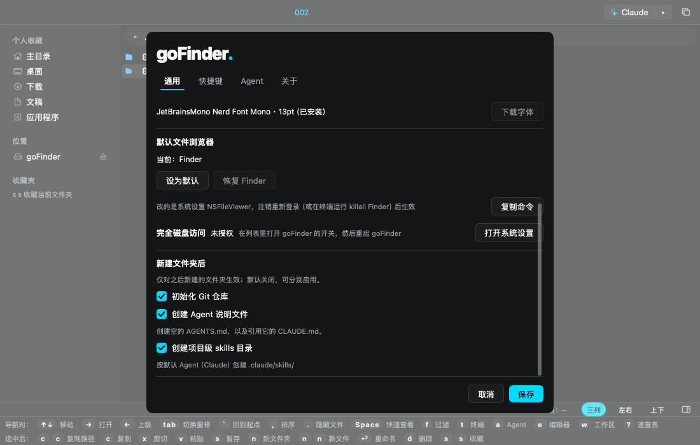

# PRD：新建文件夹后的可选初始化（Issue #4）

> 来源：Codex Issue 受理与需求规划会话，2026-11-13；[Issue #4](https://github.com/aoyamashou/goFinder/issues/4)。已先回复接受，本轮只处理此 Issue。
> 要改什么及为什么：在设置中提供三个独立、默认关闭的新建文件夹初始化选项，减少建立开发项目时重复执行 Git 初始化、创建 Agent 说明文件与 skills 目录的操作。
> 边界：只作用于本应用“新建文件夹”成功创建的目录；不改已有目录、复制/移动/解压流程、快捷键、Agent 启动命令、依赖、README、官网、版本号或发布渠道。不创建 PR、不合并、不发版。
> 状态：Claude 已审查（2026-11-13），**可以执行**；以修订后的正文为准，见文末「Claude 审查记录」。实现已完成，待 Claude 代码审查；验证及交接见文末。
> 功能分支：`feature/issue-4-folder-init`；基线：`cb04bb8`（origin/main，0.18.9）。本轮不带入 Issue #3 图标分支的规划提交。

## 1. 需求判断

需求合理且有必要作为可选功能提供：项目已有面向 Claude/Codex 等工具的 Agent 入口，初始化项目资料与定位一致；三个动作成本有限，不需要后台轮询或新依赖。

不宜默认为每个普通文件夹创建 Git 仓库和隐藏目录，因此三个选项全部默认关闭，相互独立。Issue 未指定说明文件模板、文件大小写及 skills 路径；这些属于可在 PRD 明确的实施选择，尚不足以认定需求无法理解并关闭。由 Claude 审查下列明确方案，有分歧则修改本文后再放行，不由实现阶段临时猜测。

## 2. 完成标准与失败门槛

1. 设置能独立保存三个选项，重启后保留；旧配置没有新字段时全部关闭。
2. 关闭时保持现有新建行为；开启时仅对本次成功创建的实际目录执行一次，不因刷新、重新绘制或文件监听重复执行。
3. 键盘、菜单栏及右键的新建文件夹入口行为一致；不改 `n`、`n n` 或其他动作绑定。
4. Agent 文件的名称、内容和 skills 路径严格符合下文；不复制上级目录或用户全局配置，不覆盖已有文件。
5. Git 不可用、超时、写文件失败等情况有明确反馈；保留已创建目录与成功步骤，不自动永久删除或回滚用户数据。
6. 慢操作不阻塞 UI；用户切换目录/窗格后，结果不夺回焦点、不把其他目录作为执行目标。
7. 有代表性的功能与失败测试通过，浅深色设置截图可读，完成项目最低验证；实现记录与实际限制写回本文和 `docs/plan.md`。

必须先解决：默认开启、目标目录错误、动作重复、UI 卡顿、覆盖文件、错误被当作成功、取消设置仍改变这三个选项、后台结果污染已切换窗格。未解决不得标记完成。

## 3. 已核实的仓库现状

| 位置 | 事实与影响 |
|---|---|
| `gui/actions.go`、`gui/chrome.go` | 已有统一 `newfolder` 动作与右键入口；无需新建快捷键动作 |
| `gui/app.go` 的 `submitDialog` | `dlgNewFolder` 当前同步调用 `fsops.NewFolder`；创建后按返回路径聚焦并重新加载 |
| `internal/fsops/fsops.go` 的 `NewFolder` | `UniqueName` 决定实际路径，随后 `os.Mkdir`；初始化必须使用返回路径，不能自行拼原始名称 |
| `gui/sys.go` | `config`、`defaultConfig`、`loadConfig`、`saveConfig` 可承载新字段，缺失布尔值为 false |
| `gui/view.go`、`gui/app.go` | 通用页有“保存/取消”，`setConfirm` 等临时设置值在打开时载入、保存时应用；新选项遵循此语义 |
| `internal/git/git.go` | 现有包专用于只读状态查询，不把初始化副作用混入 `Load` 或 `FindRoot` |
| `internal/agents/` | 现有职责为 Agent 目录、检测与启动配置，尚无项目文件初始化功能 |
| `docs/design-system.md`、MyGo 维护技能 | 设置复用原生控件和 token；后台只处理数据，结果经 `a.post` 回主线程，不保存临时 UI 元素 |

## 4. 产品与配置方案（已按 Claude 审查修订）

在“设置 → 通用”内增加“新建文件夹后”分组，放在现有通用设置内容中，不增加设置标签或改变面板尺寸。三个复选框及配置字段如下：

| 文案 | `config.json` 布尔字段 | 行为 |
|---|---|---|
| 初始化 Git 仓库 | `newFolderGit` | 仅在新目录中执行一次本地 Git 初始化 |
| 创建 Agent 说明文件 | `newFolderAgentFiles` | 创建 `AGENTS.md` 和 `CLAUDE.md` |
| 创建项目级 skills 目录 | `newFolderSkills` | 按默认 Agent 创建 `.claude/skills/` 或 `.agents/skills/` 空目录（见 4.2） |

说明：“仅对之后新建的文件夹生效；默认关闭，可分别启用。”涉及键位的提示如确有需要，从键位表读取，不写死。

- 三项编辑值放在持久的应用设置状态中；点“保存”应用并持久化，取消或直接关闭弹窗不应用这三项。切换设置标签后仍保留本次草稿。
- 不顺手调整现有外观等选项的即时保存行为。保存失败要明确提示，不用普通设置成功文案覆盖错误；不得声称已经持久保存。
- 不要求修改配置版本或重置配置；是否需要按现有惯例升级版本由 Claude 核实决定，旧用户必须保持三项关闭。

### 4.1 Agent 说明文件

采用行业常见大写文件名作为本功能的明确约定：`AGENTS.md` 为零字节空文件，供用户后续填写；`CLAUDE.md` 的完整 UTF-8 内容为 `@AGENTS.md` 加一个换行。

Issue 的“复制一个 Claude.md”按“再创建一个引用 Agent 文件的入口文件”理解，不复制空白文件的内容，也不复制用户个人规则。大写文件名与引用必须一致，兼顾大小写敏感卷。设置说明写明文件名，避免预期差异。

使用独占创建，不覆盖文件、目录或符号链接；遇到已有同名项时保留并报告跳过，其他独立步骤继续。创建或写入失败明确指出具体文件，不自动清空或删除。

### 4.2 skills 目录

**用户决定（2026-11-13，审查会话中确认）：skills 目录按默认 Agent 选择路径，只有两种情况。** 说明文件（4.1）不受影响，始终是 `AGENTS.md` + `CLAUDE.md`。

| 默认 Agent | 创建的目录 |
|---|---|
| Claude 系：`claude`、`claude-agent-teams` | `.claude/skills/` |
| 其他任何 Agent，或没有启用任何 Agent | `.agents/skills/` |

- 「默认 Agent」与 `a` 键打开的是同一个，直接复用 `gui/agents.go` 的 `defaultAgentItem()`：`config.json` 的 `defaultAgent` 已启用时取它，否则取第一个启用的 Agent。不新增设置项、不读取 Agent 自身的配置文件。
- Claude 系 ID 集中定义在一处（例如 `internal/projectinit` 的一个小集合，或作为参数从界面层传入），不在多个地方硬编码。`openclaude` 等其他派生工具本轮按「其他」处理；以后要加入，只改这个集合并补测试。
- 路径在**提交新建时**按当时的默认 Agent 决定，与选项一起放进快照；初始化过程中用户改了默认 Agent 也不影响本次结果。
- 只建一个目录，不同时建两个，不创建符号链接。
- 设置里该复选框的说明文字要写出实际路径，随默认 Agent 变化，例如「按默认 Agent（Claude）创建 .claude/skills/」「按默认 Agent（Codex）创建 .agents/skills/」；没有启用的 Agent 时写「创建 .agents/skills/」。Agent 名称取自现有目录，不写死。

其余不变：只建空目录，不生成 `SKILL.md`、占位文件或安装任何技能，不复制用户全局 skills。目录不依赖 Agent 文件或 Git 选项。空目录不会被 Git 跟踪，属于预期行为。

### 4.3 Git 初始化

只在本次新目录初始化本地仓库，不暂存、不提交、不配置身份、不设置远端、不联网，不主动指定默认分支。即使父目录已在仓库内，开启此项也明确在新目录建立独立仓库，不用父仓库检测结果静默跳过。

使用标准库的进程接口、明确工作目录及参数，不拼接 shell 命令；设 5 秒超时并保留可理解的错误。通过可替换执行器测试，不为测试修改本机 Git 配置。无 Git 或命令行工具缺失时只提示用户自行安装，不自动安装。

**审查修订**：使用普通 `git init`（`cmd.Dir` 为新目录），尊重用户自己的 `init.defaultBranch`、`init.templateDir` 等全局配置；不加 `--template=`。从子进程环境中去掉 `GIT_DIR`、`GIT_WORK_TREE`、`GIT_COMMON_DIR`、`GIT_INDEX_FILE` 等会重定向目标的继承变量，避免误改父仓库。

**审查补充：命令行工具缺失**。macOS 上 `/usr/bin/git` 是占位程序，未装 Command Line Tools 时运行它会弹出系统安装对话框，违反「不自动安装」。执行前先判断：若 `exec.LookPath("git")` 解析到 `/usr/bin/git` 且 `xcode-select -p` 失败，则不调用 git，直接报告「未安装命令行工具，已跳过 Git 初始化」。该检查也走可替换执行器以便测试。GUI 启动时 PATH 很短，`LookPath` 找不到 Homebrew 的 git 属于预期，与现有 `internal/git.Load` 一致，本轮不扩展 PATH 查找。若目标已有 `.git`（目录、文件或符号链接）则保留并报告跳过，不重新初始化。

## 5. 实施顺序与线程约束

1. Claude 审查上述默认值、命名、空文件内容、skills 路径、Git 行为和失败语义，在本文明确标记“可以执行”，提交审查修改。
2. 配置与通用页：复用现有保存逻辑及临时设置状态；控件稳定身份，新增间距字号使用 token，不改页面其他区域。
3. 项目初始化逻辑：建议集中在小型 `internal/projectinit` 包，参数仅为实际新目录、三个选项与可替换 Git 执行器，返回逐项结果；不引入通用任务系统，不给现有只读 Git 包增加写操作。
4. 接入 `dlgNewFolder`（**审查修订：创建本身保持同步**）：`fsops.NewFolder` 仍按现状在主线程同步调用，聚焦和重新加载的现有行为完全不变；创建失败直接按现状报错，不开始初始化。创建成功后，若任一选项开启，捕获返回路径与选项快照，把初始化步骤放进一个 `a.async` 作业。
5. 步骤采用 Agent 文件、skills 目录、Git 的固定顺序，失败不妨碍其他独立步骤；不自动重试、不自动删除。全部成功、部分完成、全部初始化失败须区分，目录创建成功不可写成目录创建失败。
6. 初始化结果经 `a.post` 只做两件事：在状态栏报告结果；若该目录或其父目录仍显示在某个窗格中，刷新对应列表与 Git 状态。**回调不移动光标、不改焦点、不切换目录**，因此不需要额外的「作业被替代」判定；用户此时已经切走也无妨，副作用只作用于已捕获的路径。
7. 侧列新建沿用 `dlgDir` 的实际目标并刷新相关列表；完成后更新 Git 状态显示，不能等到无关操作后才出现仓库标记。不新增常驻监听或轮询。

允许实现文件：相关 `gui/app.go`、`gui/sys.go`、`gui/view.go`，必要的文件操作接入辅助文件及测试，`internal/projectinit/`，本文和 `docs/plan.md`。`AGENTS.md` 本轮只加本文索引。若新增控件需要 Debug 编号，按现有规范同步 `gui/debug.go`、`docs/debug-ids.md` 及相关测试。不改无关快捷键、文件操作或框架版本；扩大范围先改 PRD 复审。

## 6. 验证计划

| 场景 | 通过条件 |
|---|---|
| 默认、旧配置、分别启用及组合 | 三项默认关闭，各组合只生成所选内容，配置往返一致 |
| 保存、取消、关闭、切换标签及重启 | 保存生效，取消不应用新三项，草稿不丢失；保存失败明确可见 |
| 键盘与菜单、右键、侧列 | 统一作用于新建成功的实际路径，取消新建不产生任何文件 |
| 重名、中文、空格、引号等名称 | 使用唯一化后的路径，进程参数无命令注入，原同名目录内容不变 |
| 已有项目、复制、移动、解压、新建文件 | 不触发初始化；不扫描或补写已有项目 |
| 写文件或权限失败、已有同名项/符号链接 | 保留已有内容与成功步骤，逐项反馈；不删除目录 |
| Git 缺失、超时或退出失败 | UI 可响应，Agent 文件/skills 仍可成功，不自动安装或联网 |
| skills 路径随默认 Agent | 默认为 claude、claude-agent-teams 时只建 `.claude/skills/`；为 codex 等其他 Agent 或无启用 Agent 时只建 `.agents/skills/`；`defaultAgent` 未启用时按第一个启用的 Agent；提交后再改默认 Agent 不影响本次结果；设置说明文字随之变化 |
| 父目录在 Git 内、继承重定向环境 | 只在新目录建立仓库，不改变父仓库；不提交、不改配置 |
| 迅速切换目录/窗格、连续创建、额外帧 | 每次创建只初始化一次；初始化回调不改光标、焦点和当前目录 |
| 未装命令行工具 | 不调用 `/usr/bin/git`、不弹系统安装框，提示已跳过，其他步骤照常完成 |
| ZIP 只读路径 | 继续拒绝新建，不生成任何初始化内容 |
| 浅深色设置、滚动 | 三项及说明清晰可读，保存/取消可用，不改变 640×600 面板 |

实现阶段：纯逻辑测试使用临时目录与注入执行器；另在临时目录验证真实 Git 初始化，不在本仓库或用户项目试运行，不调用本机系统设置。`ui.Tester` 验证入口、设置持久化与失效回调，使用可控异步队列覆盖慢任务，不能只靠同步 fake 验证竞争条件。

执行 `gofmt -l gui internal`、`go vet ./...`、`go tool mygo vet .`、`go tool mygo vet ./gui`、`go test ./...`；异步改动补相关 race 检查。生成并目视检查浅深色截图，再在开发构建验证一次真实新建流程，使用临时配置和临时目录，构建如需签名使用 `Apple_self_dev`，不覆盖安装应用。

规划提交仅核对源码入口、文件路径与文档。后续实现及实际验证见文末，不把规划检查当作功能验收。

## 7. 审查与交接

- 本功能分支提交并推送 PRD，Issue #4 保持 Open；其他 Issue 本轮不回复、不修改。
- 等待 Claude 修改并提交本文。只有审查提交中明确标记“可以执行”，Codex 才按批准范围实现；不把其他 Issue 的放行结论当成本需求授权。
- 实现时在 `docs/plan.md` 按届时最新修订编号记录方案、边界与验证，引用本文；实现提交后补记“已实现：commit <提交号>”。
- 实现交 Claude 审查。PR、Merge 和最终 Issue 回复由 Claude 完成；Codex 不向 main 直接推送本需求。发版另等用户决定。

## Claude 审查记录

> 审查：Claude Code 审查会话，2026-11-13，基于 47c7751。已核对 `gui/app.go` 的 `dlgNewFolder`、`fsops.NewFolder`、设置页「保存/取消」、`internal/git.Load` 的 git 查找方式。

**结论：✅ 可以执行。** 按修订后的正文实施。

审定第 4 节的产品选择，全部同意：

- 三项独立、默认关闭，放在「通用」页，走「保存/取消」语义：同意。
- `AGENTS.md` 为空文件，`CLAUDE.md` 内容为 `@AGENTS.md` 加换行：同意。这与本仓库自身的做法一致。
- skills 目录：初版只建 `.agents/skills/`。审查指出 Claude Code 读的是 `.claude/skills/`，用户随后决定改为按默认 Agent 二选一（见 4.2），已改入正文。
- 已有同名项跳过并报告、不覆盖、不回滚：同意。
- 父目录已在仓库内时仍在新目录 `git init`：同意，这是用户主动开启的选项。

审查修订（已改入正文）：

1. **创建保持同步，只把初始化放后台**（第 5 节第 4、6 步）。初版把 `NewFolder` 也挪进 `a.async`，会改动现有的聚焦和重载时序，还要另做「作业被替代」的竞争判定。改为创建照旧同步，初始化回调只报告结果和刷新列表，不碰光标和焦点，竞争问题随之消失。
2. **去掉 `--template=`**（第 4.3 节）：用户全局的 Git 模板和默认分支是用户自己的意图，应当尊重。
3. **命令行工具缺失时不调用 `/usr/bin/git`**（第 4.3 节）：避免弹出系统安装框。

放行条件：

- 只改第 5 节列出的文件；`internal/projectinit` 保持小而纯，不依赖 MyGo。
- 第 6 节验证全部通过，并完成项目最低验证；异步部分跑 `go test -race ./gui ./internal/projectinit`。
- 真实 Git 验证只在临时目录进行。
- 实现后交回 Claude 做代码审查，再进入合并流程。

## 实现与验收结果（2026-11-13）

- 按审查提交 `6d8a44b`、`ea0eb6d` 及用户“本条通过，可以执行”实现。三项独立、默认关闭，位于通用页末尾，滚动可见；沿用保存/取消，配置版本保持 7，旧配置不启用。
- `internal/projectinit` 只依赖标准库，按 Agent 文件、skills、Git 顺序执行；文件独占创建，已有项跳过并报告，skills 的中间目录若为符号链接则报错，避免写入其他项目。成功步骤与新目录始终保留。
- skills 路径按提交时 `defaultAgentItem()` 快照选择；设置说明直接显示实际 Agent 名称及路径，Claude 系集合仅在 `SkillsDir` 一处维护。
- Git 使用普通 `git init`、5 秒共享截止时间，尊重默认分支和模板，剔除会重定向目标的继承环境变量。`/usr/bin/git` 先检查命令行工具，未安装时不调用 git，不自动安装。
- 新建目录仍同步完成并沿用原定位/重载；只有初始化放后台。完成后更新状态及仍可见的相关列表、Git 缓存，不请求窗口或列表焦点、不切换目录；刷新按结果返回时的光标项保留选择，不回到提交时的旧光标。若原新建目录读取仍在排队，完成原来尚未兑现的定位和滚动，不另发新的定位请求。
- 没有新增独立 Debug 编号：新控件归属于既有 71 号“设置 › 通用”，与该页其他设置一致。

### 自动化验证

- 逻辑测试覆盖全部八种选项组合、两种 skills 路径及其他/无 Agent、文件内容、重复初始化、已有文件/目录/符号链接保护、写入与目标目录失败、Git 缺失/退出失败/超时、命令行工具预检、环境过滤。
- 真实 Git 测试仅用临时目录和临时 Git 配置，验证嵌套仓库、中文/引号/命令样式目录名、继承目标重定向变量的隔离，以及用户默认分支和模板得到保留，没有创建提交。
- GUI 测试覆盖默认及旧配置、保存/取消/Escape、跨设置标签草稿、保存失败、默认 Agent 及回退、单键新建、菜单栏与右键入口、侧列目标、重名、创建失败与取消、不对新建文件初始化。
- 可控 worker/post 队列验证初始化快照、切换到另一窗格后回调、额外帧不重复、列表读取期间移动光标、原新建读取和初始化回调交错；完成后不夺取焦点或改变当前目录。
- 格式检查、vet 三连、`CGO_ENABLED=0 go test ./...`、`go test -race ./gui ./internal/projectinit` 均通过。

### 界面与原生验证

`TestFolderInitShots` 生成浅深色截图，已目视核对三项、说明、滚动和保存/取消按钮，面板仍为 640×600：

| 浅色 | 深色 |
|---|---|
|  |  |

使用临时开发入口构建独立的 `Issue4Check.app`，以 `Apple_self_dev` 签名并通过严格签名检查；用户 HOME、应用数据、缓存与目标项目均放临时目录，没有覆盖安装应用。通过 `computer-use` 操作原生设置保存及新建对话框，实际创建中文带空格目录；核对空 `AGENTS.md`、`CLAUDE.md` 精确内容、`.agents/skills/`、`.git/HEAD` 和保存的三项配置，随后进入目录确认 Git 分支与未跟踪标记。

原生自动化在后台操作，完成结果在后续键盘事件后读取到；未据此声称验证了后台窗口无需输入时的即时重绘。未在本机卸载命令行工具来制造失败，该场景用注入执行器验证。未测试自动更新或发布产物。

### 交接

本轮仅实现 Issue #4，保持 Open，不再回复 Issue。代码及证据推送至本功能分支，等待 Claude 代码审查；PR、合并和最终 Issue 回复由 Claude 负责。未改 README、官网、依赖、版本号或发布渠道。
