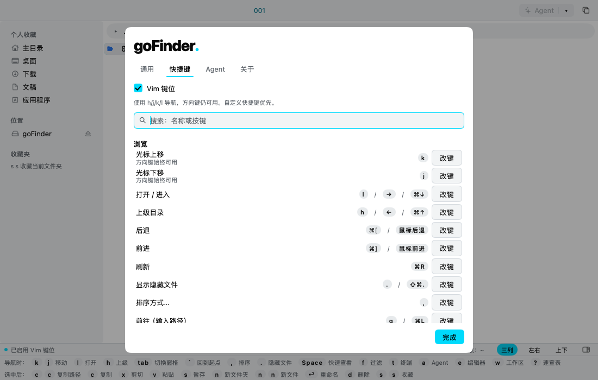
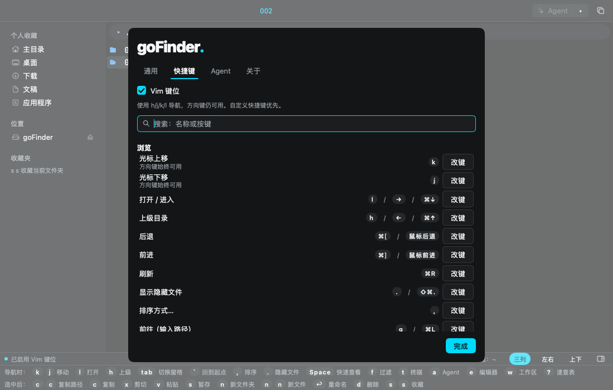
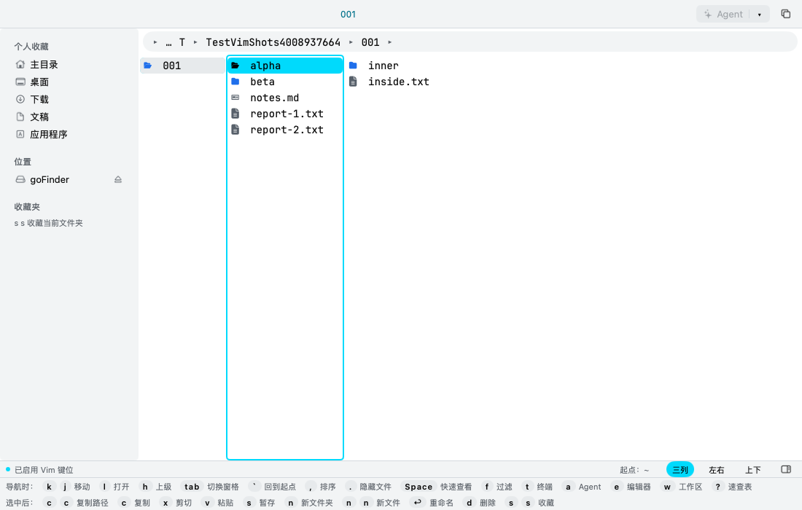
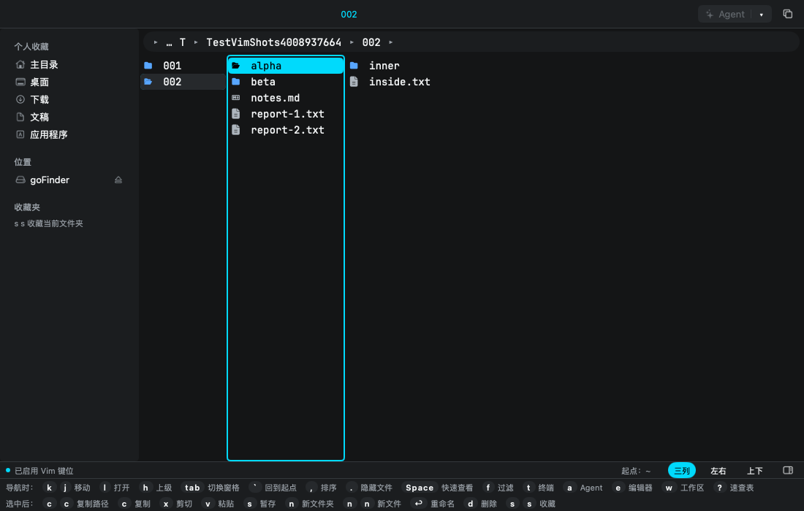

# PRD：可选 Vim 键位

> 来源：goFinder Codex 需求规划会话，2026-11-12。
> 原始需求：[GitHub Issue #2：希望支持可选的 Vim 键位（hjkl 移动）](https://github.com/aoyamashou/goFinder/issues/2)。
> 会话补充：用户明确要求在设置中增加「Vim 键位」开关，允许自行选择。
> 状态：已实现并验证，尚未发版；实现结果与已知限制见文末。
> 审查：Claude Code 审查会话，2026-11-12，**有条件放行**（结论与修改见文末「审查结论」；正文已按审查意见修订，以修订后的正文为准）。

## 要改什么及为什么

在「设置 → 快捷键」中增加默认关闭的「Vim 键位」开关。开启后支持 h/j/k/l 导航，同时保留方向键，让习惯 Vim、Yazi 的用户无需离开主键区；未开启的用户继续使用现有方向键体验。

补齐可绑定的光标上移、下移动作，让移动键也能通过现有改键入口和 keymap.json 配置。所有提示读取实际生效的键位，避免设置与界面提示不一致。

## 边界：明确不改什么

- 不改变默认方向键体验，不自动为已有用户启用 Vim 键位。
- 仅提供 hjkl，不实现 gg/G、其他多键序列、Vim 模式体系或 Vim 连选模式。
- 不改变现有 Shift 连选、文件打开、上级目录、布局或文件操作规则。
- 本次 hjkl 导航作用于当前文件列表；不扩展侧边栏、父目录列、预览列表等控件的 Vim 导航。
- 不引入依赖、插件或动画，不升级 MyGo。
- 不改官网；README 须另获用户授权后修改。
- 不安装覆盖本机应用，不修改默认文件浏览器，不打 tag 或发布 Release。
- 交付包含应用实现、回归测试和验收记录；不自动发版。

## 1. 已核实的现状

- 项目锁定 MyGo v0.8.3。
- gui/actions.go 已有 up（上级目录）、open（打开 / 进入），可复用为 h/l。
- 上下移动尚无独立动作，由 MyGo 的 ui.List 内部处理，不能只加 j/k 配置便完成需求。
- gui/hints.go 中的「↑↓ 移动」固定显示，需要改为读取有效绑定。
- 设置的「快捷键」页已有录制、清除、恢复默认能力，改键即时保存。
- 当前键位叠加顺序为默认键位、自定义命令、keymap.json，后者优先。
- 规划阶段相关 6 项现有测试通过；这不构成新功能的验收结果。
- （审查补充，已对照 MyGo v0.8.3 源码核实）
  - `ui.List` 在 `ui/list.go` 里用**元素级** `Shortcut` 自己处理 ↑↓、Home/End 和 ⇧↑↓；元素级快捷键「最内层先得」，优先于 `view.go` `dispatch` 里的窗口级 `c.Shortcut`。所以列表获得焦点时，方向键永远由列表执行，应用的键位表**拦不住、也改不了**它。
  - 列表的 Shift 连选起点（`pivot`）是私有字段，应用从外部改 `ts.cursor`／`ts.sel` 时它不会跟着重置；公开接口只有 `ExtendTo`（从 pivot 延伸）、`ScrollIntoView` 等，没有「选中某行并设为起点」的公开方法。
  - `ts.list` 没有设置 `ListState.Label`，列表不做「按字母跳转」，h/j/k/l 不会被列表当作输入吃掉。
  - 现有默认键位没有占用 h/j/k/l；菜单栏加速键只取 ⌘/⌃ 组合（`menuAccel`），单键不会进菜单栏。
  - `setKeys` 的「默认」取 `a.km.Defaults(id)`，即传给 `keymap.New` 的默认表；`config.json` 已有 `saveConfig`。

## 2. 设置入口与交互

在「设置 → 快捷键」页的快捷键列表之前放置「Vim 键位」开关，沿用项目原生控件和设计 token。

说明文案：**使用 h/j/k/l 导航，方向键仍可用。自定义快捷键优先。**

| 状态 | 文件列表导航 | 默认提示 |
|---|---|---|
| 关闭（默认） | ↑/↓ 移动，← 上级，→ 打开 | 方向键 |
| 开启 | k/j 移动，h 上级，l 打开；方向键仍可用 | 优先显示 hjkl |

- 切换后即时生效并保存，无需重启；「完成」只关闭设置，不撤销切换。
- 重启后保留选择，旧配置缺少该字段时视为关闭。
- 切换时结束正在进行的按键录制，并清空待判定的同键双击，避免旧绑定延迟执行。
- 保存失败时显示明确错误；不得提示已经保存成功。
- 用户自定义配置可能改变表中绑定；界面展示最终生效的键位。

## 3. 动作和预设

新增动作 ID 为规划命名，实现时在 gui/actions.go 集中维护，不在其他界面硬编码 hjkl。

| 动作 ID | 标题 | 方向键预设 | Vim 预设（按提示优先顺序） |
|---|---|---|---|
| cursor.up | 光标上移 | （无） | k |
| cursor.down | 光标下移 | （无） | j |
| up（已有） | 上级目录 | Left、Cmd+Up | h、Left、Cmd+Up |
| open（已有） | 打开 / 进入 | Right、Cmd+Down | l、Right、Cmd+Down |

其余默认键位不变。l 复用 open 的完整语义：文件夹进入，文件按现有方式打开，压缩包沿用现有浏览规则。

**审查修订：↑↓ 不进键位表。** ↑↓（及 Home/End、⇧↑↓）继续由 `ui.List` 原生处理，和现在一样不可改键；`cursor.up`／`cursor.down` 只承载额外的移动键（Vim 预设的 k/j，或用户在 keymap.json 里自定的键）。原因：列表的元素级快捷键优先于应用的窗口级分发，把 Up/Down 写进键位表会造成「看起来能清除、实际清不掉」「改给别的动作却被列表吃掉」的假配置。方向键模式下这两个动作没有键，属正常状态。

## 4. 配置和冲突规则

config.json 增加布尔字段 vimKeys，默认 false。

有效键位按以下顺序生成，后层保留现有覆盖优先级：

1. 默认方向键预设。
2. vimKeys 开启时应用 Vim 预设，作为当前模式的基础键位。
3. config.json 中自定义命令的 keys。
4. keymap.json 中用户按动作设置的覆盖。

- 开关只保存 vimKeys，不把预设绑定写入 keymap.json，不覆盖或删除用户自定义内容。
- 切换通过同一套构建逻辑重建键位，保证即时切换与重启后的结果一致。
- 用户给其他动作绑定 h/j/k/l 时，沿用现有冲突处理和说明机制；开关保持开启，但不得静默夺走该自定义键。
- 用户对 `cursor.up`／`cursor.down` 配置空绑定时，j/k 不再移动；↑↓ 属列表原生行为，不受影响（设置页该两行的说明里写明「方向键始终可用」）。把 Up/Down 绑给其他动作会被列表先处理，这是现有限制，本次不解决，也不新增拦截。
- 动作行「默认」移除该动作的用户覆盖，恢复当前模式下的基础键位；自定义命令仍按现有规则处理。
- **实现约束（审查补充）**：
  - 预设做成 `defaultKeys(vim bool)`，由它直接产出当前模式的基础表交给 `keymap.New`，这样 `Defaults(id)`、速查表、「默认」按钮天然与模式一致；不要另做一层 `Override` 再去修补 `Defaults`。
  - 切换开关时用内存里的 `a.kmFile` 重建键位，不重新读盘，避免与尚未写完的 `keymap.json` 异步写入竞争。
  - 已知边界：`setKeys` 会把「被抢走键的其他动作」整行写进 keymap.json（现有行为）。Vim 开启时若这样连带写入，可能把预设里的 h/l 一并固化；这是用户主动改键的结果，接受，不为此改 `setKeys` 的现有语义。
- 关闭开关只撤去 Vim 预设，用户明确写入 keymap.json 的 hjkl 仍然保留。关闭不等于清除用户配置。

## 5. 导航、焦点与状态一致性

- 单次 j/k 或 ↑/↓ 只移动一行；长按连续移动，不引入双击等待延迟。
- 空列表和首尾边界安全；光标行始终滚动到可见区域。
- 移动后的选中项、后续复制等操作目标及预览结果，与原方向键行为一致。
- j/k 的移动结果须与列表原生 ↓/↑ 一致：选择只剩新行（与原生「move」相同）、`ts.cursor` 指向新行、`ScrollIntoView`；空列表不动，首尾不越界，无光标时 j 落到第一行。
- Shift 连选在使用 j/k 移动后应从新位置延伸。由于 pivot 私有（见第 1 节），先用 ui.Tester 验证；若锁定版本没有公开方式让起点跟随，**接受降级**：j/k 后的 ⇧↑↓ 从列表上次原生移动的位置延伸，在 plan.md 修订记录里写为已知限制。不修改、不 fork MyGo，不做反射等私有字段操作。本次不新增 Shift+J/K。
- 只操作真正获得文件列表焦点的窗格；左右、上下分栏中另一窗格不变。
- 地址栏、过滤框、重命名框和设置搜索框中的 hjkl 用于输入，不触发文件导航。
- 弹窗、菜单、按键录制或侧边栏获得焦点时，不移动背后的文件列表；保留控件原有的方向键行为。
- 保持列表虚拟化，不在每次移动时遍历全部文件、读取目录或启动后台轮询。

## 6. 实施顺序与关键技术风险

### 第一步：验证列表按键分发

优先级已由审查核实（第 1 节）：↑↓ 由列表执行，j/k 走现有 `dispatch` → `run(id)`，两者天然不会重复移动。本步只需用 ui.Tester 验证三件事：

1. `run("cursor.down"/"cursor.up")` 对当前窗格的 `ts.cursor`、`ts.sel` 和滚动的结果与原生 ↓/↑ 相同；
2. 长按 j 连续移动（`dispatch` 走 `c.Shortcut` 能收到自动重复；h/j/k/l 没有双击变体，`Press` 不会等待）；
3. j/k 之后 ⇧↑↓ 的起点，按第 5 节决定是否降级。

不以修改框架依赖作为方案。

### 第二步：动作、配置与开关

- gui/actions.go：注册上下移动动作、集中维护预设，统一启动、切换、改键和恢复默认的构建规则。
- gui/sys.go：增加 vimKeys 字段，复用现有配置加载与保存。
- gui/view.go、gui/app.go：设置入口、切换状态清理、焦点约束和导航执行；具体落点以第一步验证结果为准。
- 保存走项目既有异步机制，UI 状态更新遵循主线程规则；不保存临时 UI 元素。

### 第三步：同步所有展示

- gui/hints.go：`@move` 在 `cursor.up`、`cursor.down` 都有键时显示两者首键（Vim 预设为「k j 移动」，两个键帽），否则显示「↑↓ 移动」（方向键始终可用，所以移动提示永不消失）。只有一个有键时也显示「↑↓」，不伪造组合。
- gui/menu.go：新动作加入菜单，满足 TestMenuCoversActions。
- 速查表、设置、右键菜单及提示均读取统一键位表，切换后同步更新。

### 第四步：测试与文档收尾

先通过下列验收清单，再执行项目最低验证和原生窗口检查。开发前再次检查工作区状态，确认开发会话角色；不覆盖其他会话改动。

## 7. 验收清单

| 场景 | 通过条件 |
|---|---|
| 默认与旧配置 | 开关关闭，方向键行为和默认提示保持一致 |
| 开启与关闭 | 即时切换；关闭撤去预设 hjkl，保留用户明确配置 |
| 持久化 | 关闭设置、重开设置及重启后状态和有效键位一致 |
| 连续移动 | 单击一行、长按连续；不重复移动，不等待双击超时 |
| 列表边界 | 空目录、首行、末行及过滤后列表均无越界 |
| 滚动与预览 | 光标保持可见，预览跟随当前项，后续操作目标正确 |
| 多选后移动 | j/k 与原方向键一致（选择只剩新行）；⇧↑↓ 起点正确，或按第 5 节降级并记录 |
| 文件与目录 | h/l 的上级、进入和打开行为与现有动作一致 |
| 焦点隔离 | 输入 hjkl 正常；菜单、弹窗和侧边栏不误动文件列表 |
| 双窗格 | 仅当前获得文件列表焦点的窗格移动 |
| 自定义冲突 | 自定义键优先，冲突有说明，切换不改写覆盖文件 |
| 清除与恢复 | 清除 j/k 后 j/k 不再移动、↑↓ 仍可用；「默认」恢复当前模式预设 |
| 切换中的状态 | 录制和双击等待正确结束，不执行旧动作 |
| 保存失败 | 有明确错误提示，不误报持久化成功 |
| 展示一致性 | 状态栏、菜单、速查表及设置均显示实际有效绑定 |

实现阶段执行：

```bash
gofmt -l gui internal
go vet ./...
go tool mygo vet .
go tool mygo vet ./gui
CGO_ENABLED=0 go test ./...
```

使用 ui.Tester 增补相关回归测试；检查浅色、深色截图，并在开发构建的原生窗口验证长按、焦点及滚动行为。若改动共享状态，再运行相应 race 检查。

## 8. 文档与交付约定

- 本需求只维护本文件这一份最新 PRD，后续决策直接更新本文。
- 实现时在 docs/plan.md「测试和验证」之前按实际最新编号追加修订记录；规划时下一个编号为「阶段 18 后修订十五」。记录来源 Issue #2、实施边界、实际方案与验证，并引用本 PRD，不复制维护第二份需求。
- 实现时将 AGENTS.md 中的键位规则更新为「默认方向键，可选 Vim 键位」，保留快捷键集中定义和既有序列限制。
- 完成后在本文末尾标注「已实现：commit <提交号>」，并按仓库规则补齐修订记录中的实现提交号。
- 功能提交不自动改版本、打 tag 或发版；用户明确要求发版时再处理版本和 CHANGELOG。

## 审查结论

> 审查：Claude Code 审查会话，2026-11-12。依据：本文初版（a3ceb2f）与 MyGo v0.8.3 本地源码、`gui/actions.go`、`gui/view.go`、`gui/hints.go`、`internal/keymap`。

**结论：✅ 有条件放行，Codex 可按修订后的正文开工。**

需求合理：默认关闭、不改现有用户体验，与 Issue #2 一致；h/j/k/l 不与现有默认键冲突；改动面集中在 `actions.go`、`hints.go`、设置页和 `sys.go`，资源开销可忽略。

审查对正文做了以下修订（已直接改入对应章节）：

1. **↑↓ 不进键位表**（第 3、4 节）。初版让 `cursor.up/down` 默认绑 Up/Down，并要求「清除后不被框架绕过」。核实后列表的元素级快捷键优先于应用分发，这条要求在不改 MyGo 的前提下做不到，且会产生假配置。改为 ↑↓ 保持列表原生、不可改键，`cursor.up/down` 只承载 k/j 等额外键。
2. **预设实现方式**（第 4 节）：`defaultKeys(vim bool)` 直接产出模式基础表，保证「默认」按钮与速查表一致；切换时用内存 `kmFile` 重建，不重新读盘。
3. **Shift 连选起点**（第 5 节）：pivot 私有、外部改光标不重置，允许按规定降级并记录，禁止改框架或碰私有字段。
4. **状态栏移动提示**（第 6 节第三步）：方向键始终可用，移动提示永不消失；去掉「两键都无时隐藏」。
5. 第 6 节第一步从「待验证的技术风险」缩小为三项具体的 ui.Tester 验证。

放行条件（实现时必须满足）：

- 只改上面列出的范围；README 未经用户同意不改，不改官网，不发版。
- 实现前确认自己是唯一的开发会话；提交只 `git add` 自己改的文件。
- 同步更新 `AGENTS.md` 键位规则（「默认方向键 + 可选 Vim 键位 h/j/k/l，默认关闭」）、`gui/actions.go` 中 `defaultKeys` 的注释、`docs/plan.md` 修订十五。
- 第 7 节验收清单全过，最低验证（gofmt、vet 三连、`go test ./...`）通过，并附浅色／深色截图核对设置页开关与状态栏提示。

## 实现与验收结果（2026-11-12）

- 已按审查后的正文实现设置开关、模式预设、额外移动动作、焦点隔离与统一提示；开关默认关闭，用户自定义优先，切换不改写 keymap.json。
- 回归测试覆盖第 7 节清单；格式检查、vet 三连和全量无 cgo 测试通过。
- **已确认并采用批准的降级**：j/k 后的 Shift+↑↓ 仍沿用上次列表原生导航的连选起点。例如 Home、j、j、Shift+↓ 会选择第 1–4 行。未修改 MyGo 或访问私有字段。
- 原生测试窗口验证了开关、h/l、连续 j 移动及滚动；自动重复事件由 ui.Tester 验证，未进行原生物理长按测试。测试使用 Apple_self_dev 签名和临时配置，没有覆盖安装应用。
- 实施记录见 [docs/plan.md 的修订十五](../docs/plan.md)。

### 验收截图

截图来自 `MYGO_SHOTS=/临时目录 go test ./gui -run '^TestVimShots$'`，为开启 Vim 键位的状态；默认关闭状态也已生成并核对。

| 场景 | 浅色 | 深色 |
|---|---|---|
| 设置开关与动作绑定 |  |  |
| 主界面与导航提示 |  |  |

已实现：commit 800f7a0。
